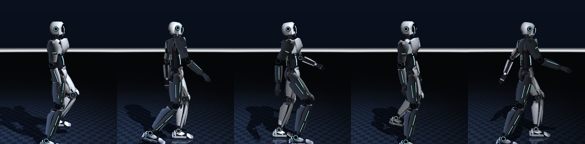
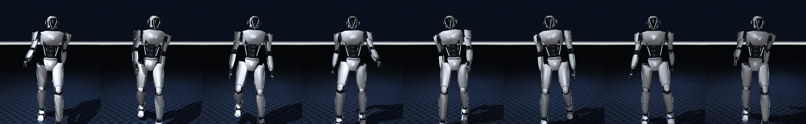
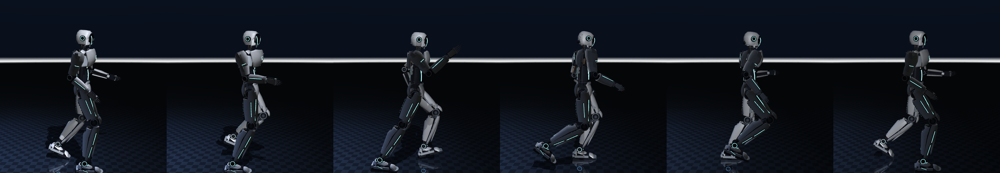
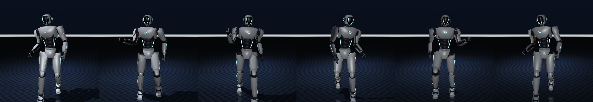

# Humanoid Robot Prototype — Three.js Digital Twin & MuJoCo GPU RL Locomotion

一个从 **Three.js 程序化机器人建模** 到 **MuJoCo 物理导出校验**，再到 **RTX GPU 并行强化学习（Walk 行走 & Run 跑步 + ONNX 导出）** 的端到端双足人形机器人项目。

An end-to-end bipedal humanoid project spanning procedural **Three.js** CAD/rigging, **MuJoCo MJCF** physics export & validation, and **GPU-accelerated RL locomotion (Walk & Run)** trained with **MuJoCo-Warp + RSL-RL PPO**.

---

### Gait Showcase | 步态效果展示

**Walk (`vx = 0.9 m/s`, upright `torso_pitch = +0.3°`, `pelvis_z = 1.032 m`, symmetric forward swing):**




**Run (`vx = 2.2 m/s`, evaluated up to `2.34 m/s`, `elbow ≈ 62°–69°`, `150 N` push recovery):**




---

## Key Specifications | 核心规格

* **Height & Mass**: `1.800 m` tall, `81.40 kg` across `57` procedural structural parts (`35` entry types)
* **Articulation**: `35` active semantic DOFs (`+ 10` coupled finger DOFs + `6` floating-base DOFs) exported to MuJoCo (`34` joints, `33` position servos, `15`-dim onboard sensor suite)
* **RL Control Policy**: `21`-DOF core locomotion policy (`50 Hz` control at `sim_dt=0.004 s`, `decimation=5`), asymmetric Actor (`74`-dim noisy obs) / Critic (`82`-dim privileged obs), trained with `1024` parallel GPU environments (`MuJoCo-Warp` + `RSL-RL 6.0.0`)
* **Pretrained Models Included** (`mujoco/rl/checkpoints/`):
  * `latest_walk.pt` / `latest_walk.onnx` — stand (`0.0002 m/s`), slow/normal/fast walk (`0.55–1.36 m/s`), turning, `150 N` push recovery
  * `latest_run.pt` / `latest_run.onnx` — jog to fast run (`1.43–2.34 m/s`), turning, `150 N` push recovery

For full architecture diagrams, Phase 1–3 benchmarks, and Walk `v1 -> v4` biomechanical debugging logs, see the **[Technical Report](docs/TECHNICAL_REPORT.md)**.

---

## Quick Start | 快速开始

### 1. Play Pretrained Walk & Run in the 3D MuJoCo Viewer (Auto-Follow + Slow-Mo)

```powershell
# Create Python 3.12 venv (uv recommended) and install CUDA PyTorch + MuJoCo RL stack
uv venv --python 3.12
.venv\Scripts\activate
uv pip install torch --index-url https://download.pytorch.org/whl/cu126
uv pip install -r mujoco/rl/requirements.txt

# 1) Launch interactive Walk viewer (defaults to Tracking camera + 0.40x slow-motion)
python mujoco/rl/play.py --viewer

# 2) Front-view / Side-view camera presets
python mujoco/rl/play.py --viewer --cam follow_front
python mujoco/rl/play.py --viewer --cam follow_side

# 3) Launch Run policy (0.40x slow-mo or 1.0x real-time sprint)
python mujoco/rl/play.py --checkpoint mujoco/rl/checkpoints/latest_run.pt --vx 2.0 --viewer
python mujoco/rl/play.py --checkpoint mujoco/rl/checkpoints/latest_run.pt --vx 2.4 --speed 1.0 --viewer
```

**Viewer Hotkeys (Interactive 3D Window):**

| Key | Action |
| --- | --- |
| `Space` / `P` | Pause / Resume simulation |
| `N` / `.` | Single-step `0.02 s` while paused |
| `-` / `=` (`J` / `K`) | Adjust slow-mo / speed (`0.10x` – `2.00x`) |
| `F` | Re-lock Tracking camera onto robot pelvis |
| `C` | Toggle close-up (`1.45 m`) / full-body (`2.4 m`) zoom |
| `B` | Apply a `120 N` (`0.20 s`) forward push disturbance |
| `R` | Reset robot to starting pose |
| `Ctrl + Right-Drag` | Drag torso directly with mouse to perturb balance |

### 2. Run Three.js Interactive Web Prototype

```bash
npm install
npm run dev          # http://localhost:5173
npm run typecheck
npm test             # 16 unit tests (Vitest)
npm run build
npm run export:mjcf  # Re-export MJCF & 92 .obj meshes into mujoco/humanoid_robot/
```

### 3. Physics Validation & Retraining from Scratch

```bash
# Phase 1: Re-generate mujoco/scene.xml and validate mass, contacts, drop, and PD stand
python mujoco/verify_mujoco.py

# Phase 2: Classical closed-loop balance, squat cycles, single-leg weight shift, and ROM audit
python mujoco/phase2_controller.py

# Phase 3: Train Walk or Run on CUDA GPU (RTX 4070 / CUDA 12.6)
python mujoco/rl/train.py --task walk --num_envs 1024 --max_iterations 220
python mujoco/rl/train.py --task run --num_envs 1024 --max_iterations 240 --resume mujoco/rl/checkpoints/latest_walk.pt
```

---

## Repository Structure | 目录结构

```text
humanoid-robot-prototype/
├── src/                        # Three.js procedural robot builder, rig, UI & kinematics
├── scripts/export-mjcf.ts      # Three.js -> MuJoCo MJCF + .obj exporter
├── tests/robot.test.ts         # Vitest structural, mirror symmetry & kinematics tests
├── docs/
│   ├── TECHNICAL_REPORT.md     # Full technical report & tuning case studies
│   └── images/                 # Gait progression & front/side comparison strips
├── mujoco/
│   ├── humanoid_robot/         # Exported model.xml + 92 per-material .obj meshes
│   ├── verify_mujoco.py        # Phase 1 scene builder & physics validation suite
│   ├── phase2_controller.py    # Phase 2 closed-loop IMU/CoM controller & tests
│   ├── scene.xml               # Standalone MuJoCo scene (with tracking cameras)
│   └── rl/
│       ├── humanoid_env.py     # GPU-vectorized MuJoCo-Warp VecEnv
│       ├── train.py            # RSL-RL 6.0 PPO trainer + ONNX exporter
│       ├── play.py             # CPU evaluator & slow-mo tracking viewer
│       ├── requirements.txt    # Python RL dependencies
│       └── checkpoints/        # Pretrained Walk & Run .pt and .onnx policies (~3.85 MB)
├── LICENSE                     # MIT License
└── .gitignore                  # Excludes .venv, node_modules, dist, and training logs
```
