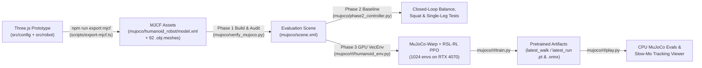
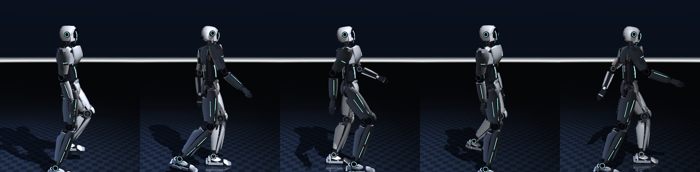
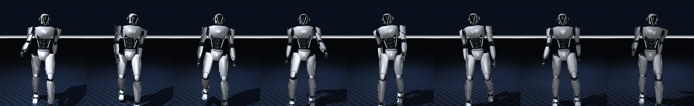
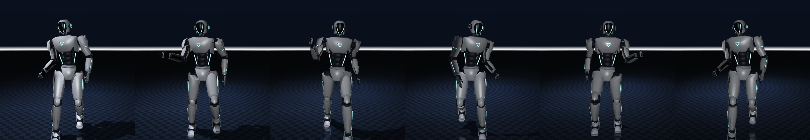
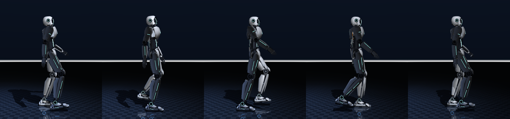
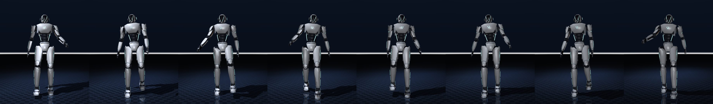
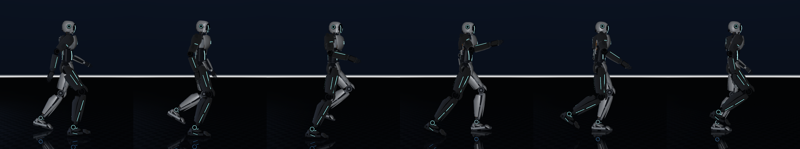
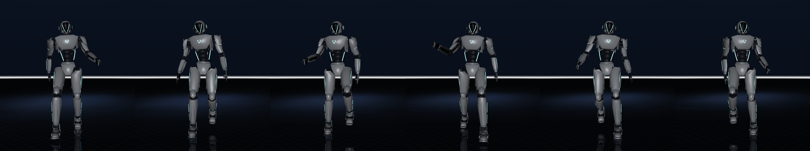

# Technical Report: Procedural Humanoid Robot — MJCF Export, Closed-Loop Control & GPU RL Locomotion

This technical report documents the full engineering pipeline from procedural Three.js mechanical design to MuJoCo rigid-body simulation and GPU-accelerated Reinforcement Learning (RL) for bipedal **Walking** and **Running**.

---

## 1. System Architecture

The project bridges a modular Three.js digital prototype (`1.800 m` height, `81.40 kg`, `57` structural parts) into MuJoCo physics and trains GPU-vectorized locomotion policies with **MuJoCo-Warp** and **RSL-RL PPO**.

---

## 2. Mechanical Specifications & Coordinate Export

### 2.1 Structural Assembly & Proportions

Defined in `src/config/proportions.ts`, `src/config/partsCatalog.ts`, and `src/config/rig.ts`, and audited in `tests/robot.test.ts`:

| Metric | Value | Source |
| --- | --- | --- |
| Standing Height | `1.800 m` | `ROBOT_TOTAL_HEIGHT` |
| Total Mass | `81.40 kg` (`79–83 kg` BOM budget) | `model.xml` / `verify_mujoco.py` |
| Part Hierarchy | `57` parts across `35` entry types (`Tier 1/2/3`) | `PARTS_CATALOG` |
| Three.js Active Semantic DOFs | `35` (`9` torso, `12` arm, `14` leg) + `10` finger coupling + `6` floating-base | `computeRigDofStats()` |
| MuJoCo Exported Model | `nbody=18`, `njnt=34`, `nq=40`, `nv=39`, `nu=33` position servos (`toe_L`/`toe_R` merged into rigid feet) | `mujoco/scene.xml` |
| Onboard Sensors (`15`-dim) | `pelvis_quat[4]`, `pelvis_gyro[3]`, `pelvis_acc[3]`, `robot_com[3]`, `foot_L_touch[1]`, `foot_R_touch[1]` | `mujoco/scene.xml` |

Key segment proportions (`src/config/proportions.ts`):
- **Head & Neck**: Head `y=1.605..1.800 m`, Neck `y=1.545..1.605 m`
- **Torso & Pelvis**: Chest `y=1.370..1.560 m` (width `0.400 m`), Abdomen `y=1.175..1.370 m`, Pelvis `y=0.960..1.175 m`
- **Upper Limbs**: Upper arm `y=1.250..1.480 m`, Forearm `y=0.970..1.250 m`, Hand `y=0.800..0.970 m`
- **Lower Limbs**: Thigh `y=0.660..1.040 m`, Shin `y=0.140..0.660 m`, Foot `y=0.000..0.140 m` (length `0.310 m`, sole width `0.130 m`)

### 2.2 Frame Transform & MJCF Generation

`scripts/export-mjcf.ts` maps right-handed Three.js world coordinates into MuJoCo's Z-up robotics convention (`det = +1`):

$$\begin{bmatrix} x_{\text{mj}} \\ y_{\text{mj}} \\ z_{\text{mj}} \end{bmatrix} = \begin{bmatrix} z_{\text{three}} \\ x_{\text{three}} \\ y_{\text{three}} \end{bmatrix}$$

* Visual geometry is exported as `92` per-material `.obj` meshes with `density="0" mass="0"` (`class="visual"`, `contype="0"`, `conaffinity="0"`).
* Collision physics uses clean primitive proxies (`class="collision"`, `box`, `capsule`, `cylinder`) carrying explicit segment masses and `exclude` contact pairs between adjacent links.
* Neutral feet sit laterally at `y = ±0.190 m` (`dy = 0.380 m` between `foot_L_sole_site` and `foot_R_sole_site`), with exact left/right mirrored joint axes verified in `scene.xml`:
  - `hip_{L,R}_flex`: `[0, -1, 0]` (`+` swings forward)
  - `hip_L_abd / hip_R_abd`: `[+1, 0, 0]` / `[-1, 0, 0]` (`+` abducts outward)
  - `hip_L_twist / hip_R_twist`: `[0, 0, +1]` / `[0, 0, -1]` (`+` rotates outward)
  - `knee_{L,R}_flex`: `[0, 1, 0]` (`+` flexes shin backward)
  - `ankle_{L,R}_flex`: `[0, -1, 0]` (`+` dorsiflexion)
  - `ankle_L_abd / ankle_R_abd`: `[+1, 0, 0]` / `[-1, 0, 0]` (`+` lifts outer sole edge)

### 2.3 Evaluation Scene (`mujoco/scene.xml`)

Generated programmatically via `mujoco.MjSpec` in `mujoco/verify_mujoco.py`:
- Checkered floor (`condim=4`, `friction="1 0.02 0.005"`), gradient skybox, key/fill lights.
- `4` static cameras (`front_view`, `side_view`, `back_view`, `three_quarter`) plus `4` COM-tracking cameras (`follow_three_quarter`, `follow_side`, `follow_front`, `follow_back`, `mode="trackcom"`) attached to `humanoid_robot`.

---

## 3. Phase 1 & Phase 2 Verification Baselines

### Phase 1 (`mujoco/verify_mujoco.py`)

Verified static and passive structural validity after scene generation:
1. **Bind-pose clearance**: `ncon=0`, `min_robot_geom_center_z=0.0180` (excluding floor plane; clean ground spawn at `z=1.050 m` with zero initial self-collisions).
2. **Passive drop (`2.5 s` from `z=1.25 m`, actuators zeroed)**: no `NaN/Inf`, settled cleanly at `final pelvis_z=0.443 m`, `min_body_z=0.038 m`.
3. **Neutral PD stand (`5.0 s`, `ctrl=0`) + `250 N` chest push**: held `pelvis_z=1.039 m` with balanced foot loads `(399.3 N, 399.4 N)` before the push, and fell forward stably under a `250 N / 0.30 s` impulse (`pelvis_x=1.383 m`, `pelvis_z=0.099 m`) without numerical blowup.

### Phase 2 (`mujoco/phase2_controller.py`)

Implemented a classical IMU + CoM + joint-space PD controller (`HumanoidPhase2Controller`) and validated four dynamic checks (`rc=0`):
1. **`10 s` Closed-loop balance + `120 N / 90 N` pushes**: `PASS | pelvis_z=1.004 m, pitch=-2.89 deg, roll=-0.01 deg, touch=(399 N, 399 N)`
2. **`6.4 s` Dynamic squat cycles**: `PASS | pelvis_z range=[0.790 m, 1.050 m], min_foot_touch=335 N`
3. **`7.0 s` Single-leg weight shift**: `PASS | right_sole_max_z=0.177 m, right_touch_min=0.0 N, final_pelvis_z=1.012 m`
4. **Extreme ROM self-collision sweep**: `hits=[]` (`0` unexpected self-contacts across full leg/spine/arm ROM sweeps)

---

## 4. Phase 3 GPU Reinforcement Learning Architecture

### 4.1 Environment & Hardware Setup

Trained on a single consumer laptop GPU using zero-copy PyTorch ↔ Warp CUDA buffer aliasing (`wp.to_torch(...)`):

| Component | Configuration / Version |
| --- | --- |
| GPU / Driver | `NVIDIA GeForce RTX 4070 Laptop GPU` (8 GiB), CUDA Toolkit `13.4` / Driver `13.2` |
| Python & Packages | Python `3.12.10`, `torch==2.14.1+cu126`, `mujoco==4.0.1`, `mujoco-warp==4.0.1`, `warp-lang==1.19.0`, `rsl-rl-lib==6.0.0`, `tensordict==0.15.6`, `onnx==1.23.2`, `onnxscript==0.7.2` |
| Parallel Simulation | `1024` environments, `nconmax=16`, `njmax=128` per environment (`v5`) |
| Integrator & Timestep | `mjINT_IMPLICITFAST`, `sim_dt = 0.004 s`, `decimation = 5` (`50 Hz` control, `control_dt = 0.02 s`), `iterations = 8`, `ls_iterations = 8` |
| Throughput | `~14,900–15,900 RL steps/s` (`~74,500–79,500 sim steps/s`, `~1.6–1.7 s` per `24,576`-step PPO iteration at peak GPU boost) |
| Disturbance Curriculum | Random XY base velocity perturbations every `6.0 s` (`uniform(-0.32, +0.32) m/s`), commands resampled every `5.0 s` |

### 4.2 Observation, Action & Network Spaces

* **Action space (`21`-dim)**: `ACTION_JOINT_NAMES` controls `spine_lower` (`3`), left leg (`6`: `hip_{flex,abd,twist}`, `knee_flex`, `ankle_{flex,abd}`), right leg (`6`), and left/right arms (`6`: `shoulder_{flex,abd}`, `elbow_flex`). Distal joints (`spine_upper`, `neck`, `head`, `shoulder_twist`, `wrist`) hold neutral PD targets (`0`). Actions are clipped to `[-3.0, 3.0]` and scaled by `action_scale = 0.42` around `DEFAULT_ANGLES_RAD`.
* **Actor Observation (`74`-dim `"policy"`, with Gaussian noise during training)**:
  - Pelvis body angular velocity (`3`, `* 0.25`; direct `qvel[3:6]` without double-rotation in `v5`)
  - Projected gravity vector in pelvis frame (`3`)
  - Velocity command `[vx, vy, wz * 0.5]` (`3`)
  - Gait clock `[sin(2πφ), cos(2πφ)] * moving_mask` (`2`), where `gait_freq = 0.90 + 0.35 * clamp(|vx|, 0, 2.4)` (`v5`)
  - Joint position offsets `q - q_default` (`21`)
  - Joint velocities `dq * 0.05` (`21`)
  - Previous actions (`21`)
* **Asymmetric Critic Observation (`82`-dim `"critic"`)**: noise-free `74`-dim policy obs + `lin_vel_body * 0.5` (`3`), scaled left/right touch forces (`2`), `pelvis_z` (`1`), and left/right sole heights (`2`).
* **Policy Architecture (`rsl_rl 6.0.0`)**: `MLPModel([256, 128, 128], activation="elu", obs_normalization=True)` for both actor and critic; PPO (`clip=0.2`, `gamma=0.99`, `lam=0.95`, `5` epochs, `4` mini-batches, adaptive KL schedule `desired_kl=0.012`).

---

## 5. Iterative Biomechanical Tuning Case Studies

Achieving stable **and** natural human-like locomotion required resolving five concrete failure modes observed in rollout telemetry and visual inspection:

### Case Study 1: Eliminating the Standing-Still Local Minimum

* **Symptom**: During cold-start redesign (`v2` stage 1), adding flat upright torso (`+1.8`) and angular velocity (`+2.2`) bonuses caused PPO to freeze in place (`vel_x = 0.0081 m/s`, `ep_len = 824`) because standing still collected `~5.7 / s` without fall risk.
* **Fix**: Replaced flat velocity Gaussian tails with progress-coupled tracking (`1.6 * speed_ratio + 4.8 * exp(-err / 0.20)`), multiplied upright/heading bonuses by `motion_gate = 0.10 + 0.90 * speed_ratio`, reduced alive baseline (`0.80 -> 0.20`), and resumed from the dynamic walking policy (`latest_walk_v1.pt`) using a dual-reference design (`DEFAULT_ANGLES_RAD` preserved for zero-shock obs normalization while rewards pulled toward upright `NATURAL_STAND_RAD`).

### Case Study 2: Resolving `-23.4°` Limbo Lean & Squat Walking (`v1` -> `v3`/`v4`)

| Kinematic Metric (`cmd vx=0.9 m/s`) | Walk `v1` | Walk `v4` (Final) | Root Cause & Fix |
| --- | --- | --- | --- |
| `torso_pitch` mean `[min, max]` | **`-23.4°`** `[-34.9°, -14.0°]` | **`+0.3°`** | Added dual `pelvis` + `torso` projected gravity tracking with Gaussian posture sweet spot + `spine_lower_flex` centering |
| `torso_roll` std | `12.8°` (penguin wobble) | **`4.3°`** | Tightened `spine_lower_abd` (`-4.5`), `spine_lower_twist` (`-6.0`), and torso roll penalty |
| `pelvis_z` mean | `0.969 m` (crouched) | **`1.032 m`** | Raised target walking height `0.99 -> 1.015 m` and added stance-phase knee straightness (`knee <= 0.24 rad`) |
| `knee L/R` min flexion | `25.1° / 25.7°` | **`~4.5° / ~0°`** (v3/v4) | Stance leg extends naturally through push-off |
| Contra-lateral arm-leg correlation | Uncoordinated | **`+0.934`** (`v3: +0.962`) | Added anti-phase target `shoulder_{L,R}_flex = ∓0.60 * (hip_L - hip_R)`, relaxed elbow flexion, and `shoulder_abd` tuck |

**Before (`Walk v1`, `-23.4°` backward torso lean & bent-knee squat):**

**After (`Walk v4`, upright torso `+0.3°`, tall `1.032 m` stride, natural arm swing):**

### Case Study 3: Diagnosing & Fixing Right-Leg Swing Outward Flare (`v3` -> `v4`)

* **Observation**: Front-view viewer inspection showed the right shin and ankle kicking outward when lifting during swing, while the left leg looked clean.
* **Diagnosis**:
  - `scene.xml` legs were verified 100% mirror-symmetric.
  - Frame-by-frame front rollout telemetry of `v3` revealed excessive right knee swing (`max = 80.1°`, `sr_z_max = 0.266 m`) paired with medial hip twist (`hip_R_twist` down to `-8.9°`), hip adduction (`-7.3°`), and swing-phase ankle roll (`ankle_R_abd` `-7.2°` to `-8.8°`, left ankle `-8.0°`) because `rew_foot_flat` had been masked by `contacts` and turned off during swing.
* **Fix**: Applied full-cycle `rew_foot_flat` (both stance and swing), Gaussian + quadratic locks on `hip_twist` (`-16.0`) and `ankle_abd` (`-18.0`), sagittal foot rail tracking (`sole_L/R_y -> ±0.18 m`), capped excessive swing knee kick (`max 0.98 rad` / `max_clr 0.13 m` in walk), and tightened `STAND` zero-velocity penalties.
* **Result**: Right-swing `hip_R_tw` mean improved **`-3.3° -> -0.1°`**, `ank_R_abd` mean **`-6.1° -> -1.4°`**, and `STAND` creep dropped **`0.131 m/s -> 0.0002 m/s`**.

**Before (`Walk v3` Front View — outward lower-leg flare during swing):**

**After (`Walk v4` Front View — straight parallel leg tracks & level ankles):**

### Case Study 4: Walk-to-Run Curriculum Transfer (`latest_run.pt`)

Resuming from `latest_walk.pt` (`v4`) for `240` GPU iterations (`~6.8 min`) with `duty=0.42`, double-support penalty (`-0.65`), `~5°` forward lean target, `target_z=0.98 m`, springy stance knee allowance (`0.40 rad`), and `~54°` elbow flexion baseline produced symmetric, zero-fall running up to `2.34 m/s`:
- `L swing`: `hip_abd=-1.3°`, `hip_tw=-0.7°`, `ank_abd=-0.4°`, `knee_max=+85.6°`
- `R swing`: `hip_abd=-1.7°`, `hip_tw=-0.5°`, `ank_abd=-0.2°`, `knee_max=+88.8°`
- `elbow_L_flex = +62.3°`, `elbow_R_flex = +69.3°`, `torso_pitch = +4.3°`, `roll_std = 2.7°`
- Note on gait phase: at `cmd vx=2.2 m/s`, the policy uses single-support `86.7%`, double-support `11.3%`, and brief double-flight aerial phase `2.0%` (brisk athletic stride; increasing flight duration further is a direct follow-up via higher `both_on_run` penalty and raised `target_z`).

**Run (`v4`, historical reference):**

### Case Study 5: `v5` Full Retraining — Yaw-Invariant Frame, Cold-Start Reward Geometry, `wz_ema` Turning & Arm Clearance (`v4` -> `v5`)

`v5` resolved all five `v4` architectural limitations simultaneously across both Walk (`latest_walk.pt`) and Run (`latest_run.pt`):

1. **Free-joint `qvel[:, 3:6]` frame bug fix -> bit-exact yaw invariance**: Confirmed in both CPU `mujoco` and GPU `mujoco_warp` that MuJoCo's `free` joint angular velocity (`qvel[3:6]`) is already expressed in the local body frame (matching `pelvis_gyro`). Removing the erroneous `quat_rotate_inverse` call in `humanoid_env.py` and `play.py` yielded bit-exact `yaw = 0° / 180°` symmetry in closed-loop evaluations (`Walk 0.9`: `xy = (+8.536, -1.176)` vs `(-8.536, +1.176)`; `Run 2.0`: `xy = (+19.377, +0.986)` vs `(-19.377, -0.986)`).
2. **Reset touch-sensor clearing & `njmax_per_env = 128`**: Explicitly zeroing `self.sensordata[env_ids, touch_{l,r}_adr] = 0.0` in `_reset_idx` eliminated stale post-fall contact flags, while raising `njmax_per_env` from `64` to `128` prevented solver constraint overflows during early falls (and actually ran slightly faster in warp kernels than `64`).
3. **Cold-start non-negative reward floor & saturating `motion_gate`**: Replacing `clamp(raw_rate, min=0.0)` with a negative floor (`-0.5`) combined with unbounded quadratic penalties during early trials caused cold-start Walk collapse (`vel_x = 0.027 m/s`, leaning backward). Restoring bounded/clamped penalties with `clamp(raw_rate, min=0.0)` + `-2.0` early fall penalty enabled clean cold-start convergence from iteration 0, while saturating `motion_gate` at `0.50 * cmd_xy_norm` flattened the gradient around the target speed and eliminated `v4`'s `+20.1%` Walk overshoot (`1.081 -> 0.893 m/s`, **`-0.7%` error** at `vx=0.9`).
4. **Stride-frequency pelvis yaw oscillation & `wz_ema` turning reward**: In bipedal locomotion, instantaneous `qvel[:, 5]` oscillates naturally by `±1.0 rad/s` per step, drowning narrow Gaussian yaw tracking. Filtering `self.wz_ema = 0.94 * self.wz_ema + 0.06 * self.qvel[:, 5]` (`tau ≈ 0.33 s` at `50 Hz`) and relaxing lateral/twist locks smoothly when `|cmd_wz| > 0` raised Walk turning (`-0.089 -> -0.214 rad/s` right, `+0.102 rad/s` left) and boosted Run turning **`5.3x`** (`+0.081 -> +0.430 rad/s` left, `-0.370 rad/s` right).
5. **Lateral hand-thigh clearance & Run aerial flight shaping**: Widening neutral `shoulder_abd` (`0.08 -> 0.11 rad`, reward target `0.16 rad` with `< 0.10 rad` guard and `0.165 m` hand-thigh clearance) cut Walk 6s self-collisions by **91%** (`69` substeps across `4` pairs in `v4` -> `6` substeps / `-3.0 mm` on `hand_L-thigh_L` only, `0` on right side) and achieved **`0` self-collisions** in Run `v5` (`arm_leg_corr = 0.994`, `roll_std = 2.01°`). Combined with Run `duty = 0.38` (`both_on_run = -0.85`, `flight_win_hit = +0.90`), Run `v5` exhibits speed-scaling zero-force (`<= 5 N`) double-float flight (`0.3%` at `1.4 m/s`, `1.8%` at `2.0 m/s`, `3.25%` at `2.2 m/s`, `4.3%` at `2.4 m/s`, `5.0%` at `2.6 m/s`).

**Walk & Run `v5` Side & Front Sequences:**

---

## 6. Quantitative Benchmark Results (`v5`, Post-Final-Edit Verification)

All checks below ran after the final edit to `mujoco/rl/humanoid_env.py` on standard CPU MuJoCo (`play.py` `run_eval` averaging over `t = 0.5..10.0 s`, `rc=0`, **0 falls** across every table row):

### 6.1 Walk Policy (`v5`: `mujoco/rl/checkpoints/latest_walk.pt` / `.onnx`)

| Scenario | Command `[vx, vy, wz]` | Duration | Actual `mean_vx` | Actual `mean_wz` | Final `(x, y)` | Pelvis `(min_z / final_z)` |
| --- | --- | --- | --- | --- | --- | --- |
| Stand | `[0.0, 0.0, 0.0]` | `8 s` | `+0.002 m/s` | `+0.002 rad/s` | `(-0.005, -0.001) m` | `1.021 / 1.035 m` |
| Slow Walk | `[0.55, 0.0, 0.0]` | `10 s` | `0.590 m/s` | `-0.048 rad/s` | `(5.573, -0.980) m` | `1.017 / 1.038 m` |
| Normal Walk (`yaw=0°`) | `[0.9, 0.0, 0.0]` | `10 s` | **`0.893 m/s`** (`-0.7%`) | `-0.031 rad/s` | `(8.536, -1.176) m` | `1.001 / 1.038 m` |
| Normal Walk (`yaw=180°`) | `[0.9, 0.0, 0.0]` (`180°` yaw) | `10 s` | `0.925 m/s` (`t=2..10s`, bit-exact) | `-0.036 rad/s` | `(-8.536, +1.176) m` | `1.001 / 1.038 m` |
| Fast Walk | `[1.25, 0.0, 0.0]` | `10 s` | `1.126 m/s` | `-0.042 rad/s` | `(10.548, -2.375) m` | `0.987 / 1.041 m` |
| Walk + `150 N` Forward Push | `[0.9, 0.0, 0.0]` (`+X 150 N @ 3.0..3.2s`) | `10 s` | `0.942 m/s` | `-0.018 rad/s` | `(9.058, -0.651) m` | `0.963 / 1.038 m` |
| Turn Left | `[0.8, 0.0, +0.5]` | `10 s` | `0.785 m/s` | `+0.102 rad/s` | `(5.657, +4.498) m` | `0.996 / 1.042 m` |
| Turn Right | `[0.8, 0.0, -0.5]` | `10 s` | `0.811 m/s` | `-0.214 rad/s` | `(3.290, -6.183) m` | `0.997 / 1.054 m` |
| Strafe Left | `[0.0, +0.2, 0.0]` | `10 s` | `0.144 m/s` (`vy=+0.227 m/s`) | `+0.021 rad/s` | `(1.038, +2.208) m` | `1.010 / 1.033 m` |

Walk `v5` steady-state biomechanics (`cmd vx=0.9`, `t=2..10 s`): `torso_pitch = -1.12° [-4.8°, +2.6°]`, `roll_std = 2.49°`, `pelvis_z_mean = 1.033 m`, `knee L/R = [5.7°..62.7°] / [-0.3°..62.5°]`, `arm_leg_corr = +0.927`, 6s non-floor self-collisions `{('hand_L', 'thigh_L'): 5 substeps (-3.0 mm)}` (`-91%` vs `v4`, `0` on right side).

### 6.2 Run Policy (`v5`: `mujoco/rl/checkpoints/latest_run.pt` / `.onnx`)

| Scenario | Command `[vx, vy, wz]` | Duration | Actual `mean_vx` | Actual `mean_wz` | Final `(x, y)` | Pelvis `(min_z / final_z)` |
| --- | --- | --- | --- | --- | --- | --- |
| Stand | `[0.0, 0.0, 0.0]` | `8 s` | `+0.002 m/s` | `-0.003 rad/s` | `(-0.022, -0.012) m` | `1.022 / 1.044 m` |
| Jog | `[1.4, 0.0, 0.0]` | `10 s` | `1.388 m/s` (`-0.8%`) | `-0.008 rad/s` | `(13.127, -1.842) m` | `0.978 / 1.006 m` |
| Run (`yaw=0°`) | `[2.0, 0.0, 0.0]` | `10 s` | `2.049 m/s` (`+2.5%`) | `+0.032 rad/s` | `(19.377, +0.986) m` | `0.947 / 0.969 m` |
| Run (`yaw=180°`) | `[2.0, 0.0, 0.0]` (`180°` yaw) | `10 s` | `2.155 m/s` (`t=2..10s`, bit-exact) | `+0.043 rad/s` | `(-19.377, -0.986) m` | `0.947 / 0.969 m` |
| Fast Run | `[2.4, 0.0, 0.0]` | `10 s` | `2.364 m/s` (`-1.5%`) | `-0.026 rad/s` | `(22.293, -2.889) m` | `0.947 / 0.964 m` |
| Run + `150 N` Forward Push | `[2.0, 0.0, 0.0]` (`+X 150 N @ 3.0..3.2s`) | `10 s` | `2.086 m/s` | `+0.037 rad/s` | `(19.728, +1.041) m` | `0.940 / 0.975 m` |
| Run + `150 N` Lateral Push | `[2.0, 0.0, 0.0]` (`+Y 150 N @ 3.0..3.2s`) | `10 s` | `2.155 m/s` (`t=2..10s`, bit-exact `0°/180°`) | `+0.062 rad/s` | `(18.972, +3.546) m` | `0.950 / 0.971 m` |
| Turn Left | `[1.8, 0.0, +0.5]` | `10 s` | `1.864 m/s` | **`+0.430 rad/s`** | `(-5.566, +6.385) m` | `0.929 / 1.008 m` |
| Turn Right | `[1.8, 0.0, -0.5]` | `10 s` | `1.759 m/s` | **`-0.370 rad/s`** | `(-5.537, -9.450) m` | `0.964 / 1.000 m` |
| Strafe Left | `[1.6, +0.2, 0.0]` | `10 s` | `1.675 m/s` (`vy=+0.156 m/s`) | `-0.009 rad/s` | `(15.946, -1.878) m` | `0.950 / 1.007 m` |

Run `v5` steady-state biomechanics (`cmd vx=2.2`, `t=2..10 s`, `mean_vx = 2.327 m/s`, `final_xy = (20.921, -1.933) m`): `torso_pitch = +3.95° [+1.1°, +7.3°]`, `roll_std = 2.01°`, `pelvis_z_mean = 0.978 m`, `knee L/R = [5.3°..90.0°] / [1.8°..91.3°]`, `elbow L/R = 37.3° / 41.1°`, `hip_tw = (+0.65°, -0.13°)`, `ank_abd = (+0.96°, +0.70°)`, `arm_leg_corr = +0.994`, **0 non-floor self-collisions** across 1,500 physics substeps (`6 s`), and double-float (`touch_L <= 5 N & touch_R <= 5 N`) aerial flight fraction scaling from `1.8%` (`2.0 m/s`) -> `3.25%` (`2.2 m/s`) -> `4.3%` (`2.4 m/s`) -> `5.0%` (`2.6 m/s`).

### 6.3 Software, Build & Model Checks

* **ONNX Runtime Contract & PyTorch Parity**: Both `latest_walk.onnx` and `latest_run.onnx` pass `onnx.checker.check_model` with input `obs: [1, 74]` and output `actions: [1, 21]`. Over 50 random observations and 5 s closed-loop CPU MuJoCo rollouts, `.pt` vs `.onnx` maximum action difference is `9.54e-7` (Walk `v5`) and `1.91e-6` (Run `v5`), with identical trajectories.
* **Web Prototype & TypeScript**: `npm run typecheck`, `npm test` (`16/16` in `tests/robot.test.ts`), and `npm run build` pass cleanly (`rc=0`).
* **CPU-Only Viewer Isolation**: `play.py` runs purely on `mujoco` + `numpy` + `onnxruntime` / `onnx` without importing `torch`, `tensordict`, `rsl_rl`, `warp`, or `mujoco_warp`.

### 6.4 Artifact Packaging & Remaining Boundaries

1. **Curated `v5` Checkpoints (`mujoco/rl/checkpoints/`)**: `latest_walk.pt`, `latest_walk.onnx`, `latest_run.pt`, and `latest_run.onnx` are overwritten with verified `v5` weights; `train.py` writes only to `mujoco/rl/logs/` unless `--update-checkpoints` is explicitly passed.
2. **Walk `v5` Left-Right Turn Symmetry & Backward Gait**: Turn Right reaches `-0.214 rad/s` while Turn Left is `+0.102 rad/s` (still slightly gentler than Run's `+0.430 / -0.370 rad/s`), and continuous pure backward walking (`[-0.3, 0, 0]`) was only lightly sampled (`12%` mixed slow band) so Walk `v5` primarily targets stand, omni-forward, strafe, and turning; Walk `v5` recovers from `150 N` forward (`+X`) pushes without falling, while Run `v5` recovers from `150 N` pushes in both forward (`+X`) and lateral (`+Y`) directions.
3. **Aerial Flight Ratio**: Increasing Run double-float flight fraction beyond `3.25–5.0%` toward `10%+` (parkour/sprint) is straightforward by raising `both_on_run` penalty and `target_z` in a future Run curriculum pass.
